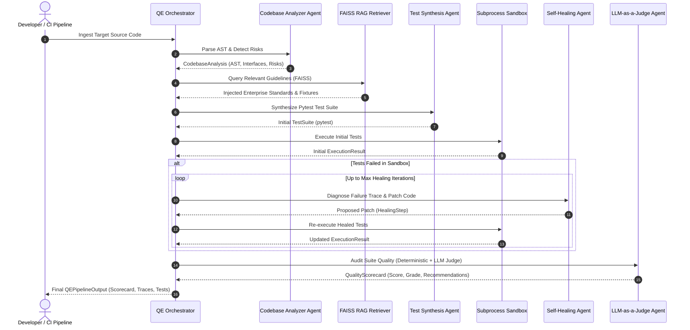

# System Architecture & Technical Specification

## 1. Executive Summary

**QualiAgent Enterprise** is a production-grade multi-agent autonomous Quality Engineering (Agentic QE) platform. It eliminates manual, flaky test creation and maintenance through autonomous code understanding, guideline-grounded test synthesis, sandboxed test execution, iterative self-healing reflection loops, and LLM-as-a-Judge quality governance.

The platform directly aligns with the technical evaluation pillars defined in the **BayOne Solutions AI-Led Engineering Program**:
1. **LLM Application Engineering**: Typed Pydantic data schemas, structured outputs, multi-provider abstraction (OpenAI, Gemini, local offline mock mode).
2. **Agent Orchestration & Tooling**: Supervisor agent architecture, dynamic AST tool use, sandboxed test runners, error reflection mechanisms.
3. **RAG Pipelines**: Hybrid semantic retrieval using FAISS vector indexing combined with BM25 keyword matching over enterprise testing standards.
4. **Prompt / Evaluation Frameworks**: LLM-as-a-Judge rubric calculating Executability Rate, Assertion Density, Interface Coverage, Mocking Faithfulness, and Hallucination Penalties.
5. **AI-Assisted Software Delivery**: CLI integration, GitHub Actions CI/CD automation, FastAPI REST endpoints, and Streamlit interactive dashboard.

---

## 2. Three-Role Alignment Matrix

| JD Role / Track | Primary Responsibilities | How QualiAgent Demonstrates Mastery |
| :--- | :--- | :--- |
| **1. Agentic QE Engineer** | Autonomous test generation, test execution, self-healing test automation, edge-case discovery, regression validation. | • AST extraction of classes, methods, and cyclomatic complexity. • Isolated subprocess pytest execution in dynamic sandboxes. • Closed-loop self-healing agent that diagnoses tracebacks and repairs failing tests. |
| **2. Agentic AI Engineer** | Multi-agent orchestration, state graphs, tool invocation, memory & context management, RAG retrieval. | • Modular multi-agent topology (`Analyzer`, `Retriever`, `Generator`, `Healer`, `Judge`). • FAISS vector indexing of enterprise testing guidelines. • Telemetry tracing with per-agent latency and status logging. |
| **3. Enterprise AI Engineer** | LLM-as-a-Judge, evaluation metrics, governance, CI/CD pipeline integration, API deployment, auditability. | • Standardized Quality Scorecards with composite QE metrics. • GitHub Actions CI/CD workflow testing pull requests automatically. • Production FastAPI backend and real-time Streamlit dashboard. |

---

## 3. Architecture Sequence Diagram

---

## 4. Component Deep Dive

### 4.1 AST Code & Risk Analyzer (`qualiagent.core.ast_parser`)
- Operates via Python's standard `ast` module.
- Calculates **McCabe Cyclomatic Complexity** by traversing decision branches (`If`, `While`, `For`, `ExceptHandler`, `BoolOp`).
- Discovers explicit raised exceptions (`raise ValueError(...)`) to generate strict `pytest.raises` test cases.
- Computes risk hotspots to prioritize test coverage on complex functions.

### 4.2 FAISS Enterprise RAG Engine (`qualiagent.rag`)
- Indexes markdown enterprise testing rules into dense vector embeddings.
- Provides vector similarity search via `faiss.IndexFlatIP` (Cosine similarity on normalized embeddings).
- Formats guideline context dynamically to guide the LLM against hallucinating non-existent class signatures or fixtures.

### 4.3 Test Synthesis Agent (`qualiagent.agents.generator`)
- Consumes AST contract signatures and RAG guideline context.
- Generates idiomatic pytest suites with:
  - Clean `@pytest.fixture` definitions for state isolation.
  - `@pytest.mark.parametrize` for edge cases and boundary conditions.
  - `pytest.raises` for negative test scenarios.
  - Unit test mocking for external side effects.

### 4.4 Self-Healing Reflection Engine (`qualiagent.agents.healer`)
- Executes test code in an isolated subprocess (`tempfile.TemporaryDirectory`).
- Parses failure outputs, capturing failing test names, exception types, and stack traces.
- Enters an automated reflection loop:
  1. Inspects failure traceback and source implementation.
  2. Identifies root causes (e.g. wrong mock attribute, assertion discrepancy, missing fixture).
  3. Formulates a targeted code patch.
  4. Re-executes inside the sandbox until tests pass or max iterations are reached.

### 4.5 LLM-as-a-Judge Evaluation Framework (`qualiagent.evaluation`)
- Evaluates test suite across multiple objective and qualitative dimensions:
  - **Executability Score** (% passing tests).
  - **Assertion Density** (average assertions per test function).
  - **Interface Coverage Proxy** (% of declared methods and functions referenced).
  - **Mocking Faithfulness** (0-10 rating).
  - **Edge-Case Coverage** (0-10 rating).
  - **Hallucination Penalty** (deductions for referencing non-existent methods).
- Produces composite score (0-100) and letter grades (A+, A, B, C, F) alongside actionable recommendations.

---

## 5. Security and Sandboxing

- Subprocess isolation ensures that test code execution cannot corrupt the host workspace.
- Configurable execution timeouts prevent infinite loops from hanging the pipeline.
- Pure-Python deterministic local mode allows offline evaluation without sharing confidential code with external cloud LLMs.
