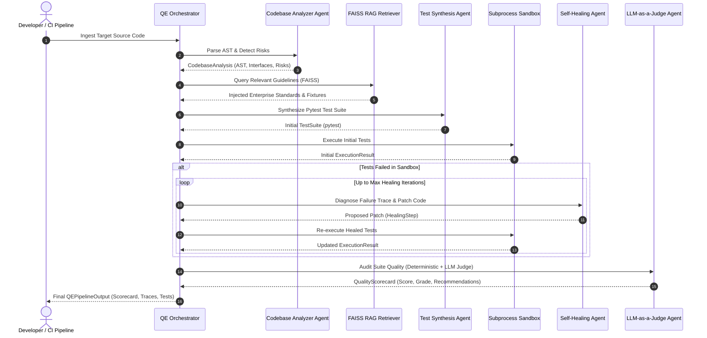

# System Architecture & Technical Specification

## 1. Executive Summary

**QualiAgent Enterprise** is a production-grade multi-agent autonomous Quality Engineering platform. It eliminates manual, flaky test creation and maintenance through autonomous code understanding, guideline-grounded test synthesis, sandboxed test execution, iterative self-healing reflection loops, and LLM-as-a-Judge quality governance.

The platform is architected around five enterprise capabilities:
1. **AST Code Analysis & Complexity Modeling**: Typed Pydantic data schemas, structured outputs, McCabe cyclomatic complexity scoring, and risk discovery.
2. **Multi-Agent Orchestration & Tooling**: Supervisor agent architecture coordinating specialized analyzer, generator, healer, and judge agents with telemetry tracing.
3. **Enterprise RAG Retrieval**: Hybrid semantic retrieval using FAISS vector indexing over enterprise testing standards and fixture rules.
4. **Autonomous Self-Healing Test Sandbox**: Isolated subprocess test runners with feedback reflection diagnosing tracebacks and patching failing assertions.
5. **LLM-as-a-Judge Evaluation & CI/CD Delivery**: Standardized Quality Scorecards, CLI integration, GitHub Actions automation, FastAPI REST endpoints, and interactive Streamlit UI.

---

## 2. Core Capabilities Matrix

| Architectural Capability | Technical Highlights | System Components |
| :--- | :--- | :--- |
| **AST Static Analysis & Complexity** | Extracts public interfaces, parameter types, raised exceptions, and McCabe cyclomatic complexity. | • `qualiagent.core.ast_parser` • `CodebaseAnalyzerAgent` |
| **Multi-Agent Supervisor Orchestration** | Coordinates specialized agents with state tracking, latency recording, and execution tracing. | • `QEOrchestrator` • `qualiagent.agents.base` |
| **RAG Guideline Grounding** | Vector similarity retrieval over enterprise testing rules using normalized FAISS indices. | • `qualiagent.rag.retriever` • `LocalEmbeddingEngine` |
| **Sandboxed Self-Healing Execution** | Ephemeral subprocess pytest sandbox diagnosing tracebacks and iteratively repairing failing tests. | • `TestSandbox` • `SelfHealingAgent` |
| **Quality Governance & CI/CD** | Programmatic QE metrics combined with LLM-as-a-Judge scorecards, CLI, and GitHub Actions. | • `QEJudge` • `agentic-qe-ci.yml` • `FastAPI` / `Streamlit` |

---

## 3. Architecture Sequence Diagram

---

## 4. Component Deep Dive

### 4.1 AST Code & Risk Analyzer (`qualiagent.core.ast_parser`)
- Operates via Python's standard `ast` module.
- Calculates **McCabe Cyclomatic Complexity** by traversing decision branches (`If`, `While`, `For`, `ExceptHandler`, `BoolOp`).
- Discovers explicit raised exceptions (`raise ValueError(...)`) to generate strict `pytest.raises` test cases.
- Computes risk hotspots to prioritize test coverage on complex functions.

### 4.2 FAISS Enterprise RAG Engine (`qualiagent.rag`)
- Indexes markdown enterprise testing rules into dense vector embeddings.
- Provides vector similarity search via `faiss.IndexFlatIP` (Cosine similarity on normalized embeddings).
- Formats guideline context dynamically to guide the LLM against hallucinating non-existent class signatures or fixtures.

### 4.3 Test Synthesis Agent (`qualiagent.agents.generator`)
- Consumes AST contract signatures and RAG guideline context.
- Generates idiomatic pytest suites with:
  - Clean `@pytest.fixture` definitions for state isolation.
  - `@pytest.mark.parametrize` for edge cases and boundary conditions.
  - `pytest.raises` for negative test scenarios.
  - Unit test mocking for external side effects.

### 4.4 Self-Healing Reflection Engine (`qualiagent.agents.healer`)
- Executes test code in an isolated subprocess (`tempfile.TemporaryDirectory`).
- Parses failure outputs, capturing failing test names, exception types, and stack traces.
- Enters an automated reflection loop:
  1. Inspects failure traceback and source implementation.
  2. Identifies root causes (e.g. wrong mock attribute, assertion discrepancy, missing fixture).
  3. Formulates a targeted code patch.
  4. Re-executes inside the sandbox until tests pass or max iterations are reached.

### 4.5 LLM-as-a-Judge Evaluation Framework (`qualiagent.evaluation`)
- Evaluates test suite across multiple objective and qualitative dimensions:
  - **Executability Score** (% passing tests).
  - **Assertion Density** (average assertions per test function).
  - **Interface Coverage Proxy** (% of declared methods and functions referenced).
  - **Mocking Faithfulness** (0-10 rating).
  - **Edge-Case Coverage** (0-10 rating).
  - **Hallucination Penalty** (deductions for referencing non-existent methods).
- Produces composite score (0-100) and letter grades (A+, A, B, C, F) alongside actionable recommendations.

---

## 5. Security and Sandboxing

- Subprocess isolation ensures that test code execution cannot corrupt the host workspace.
- Configurable execution timeouts prevent infinite loops from hanging the pipeline.
- Pure-Python deterministic local mode allows offline evaluation without sharing confidential code with external cloud LLMs.
